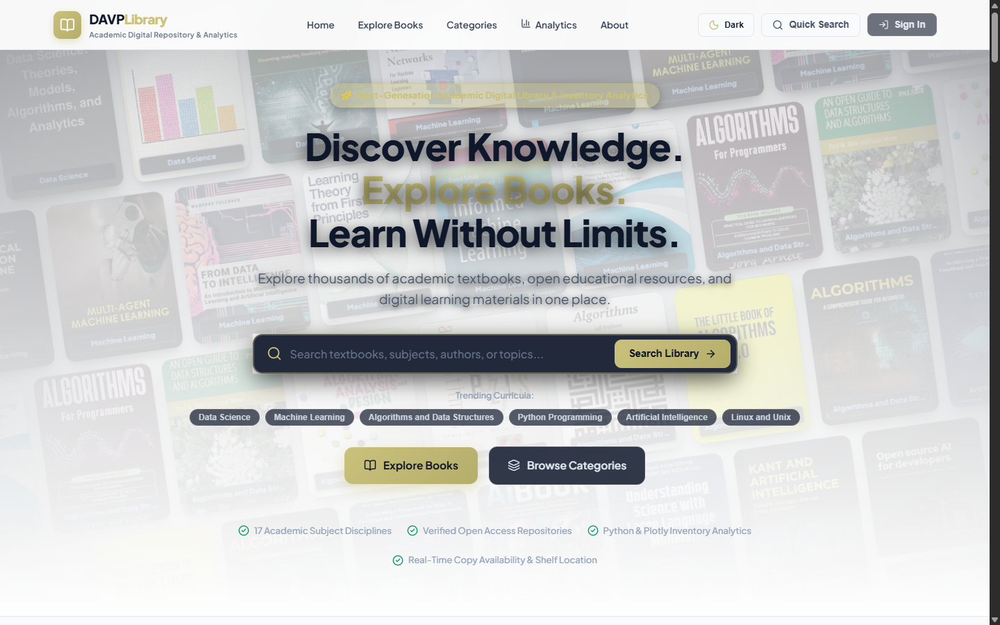
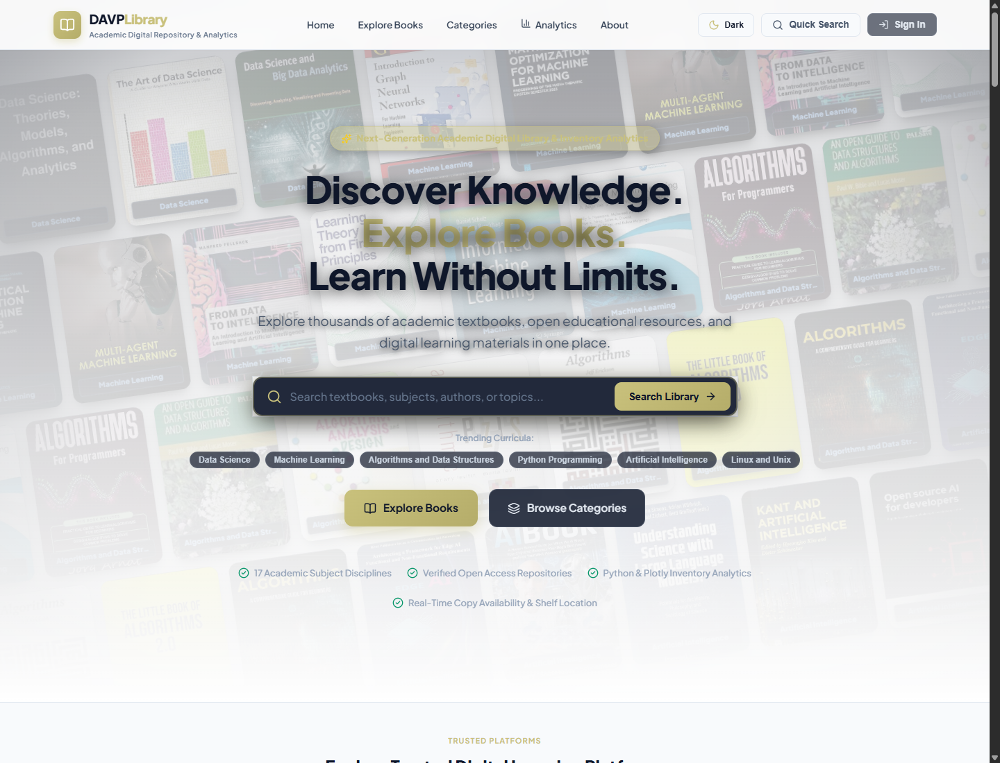
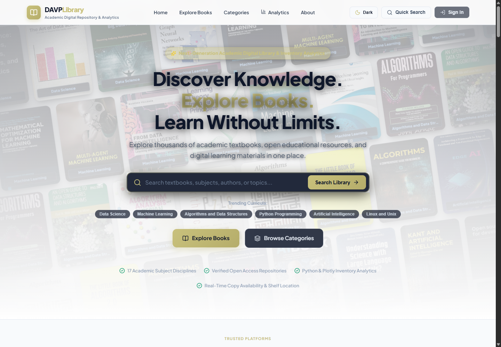
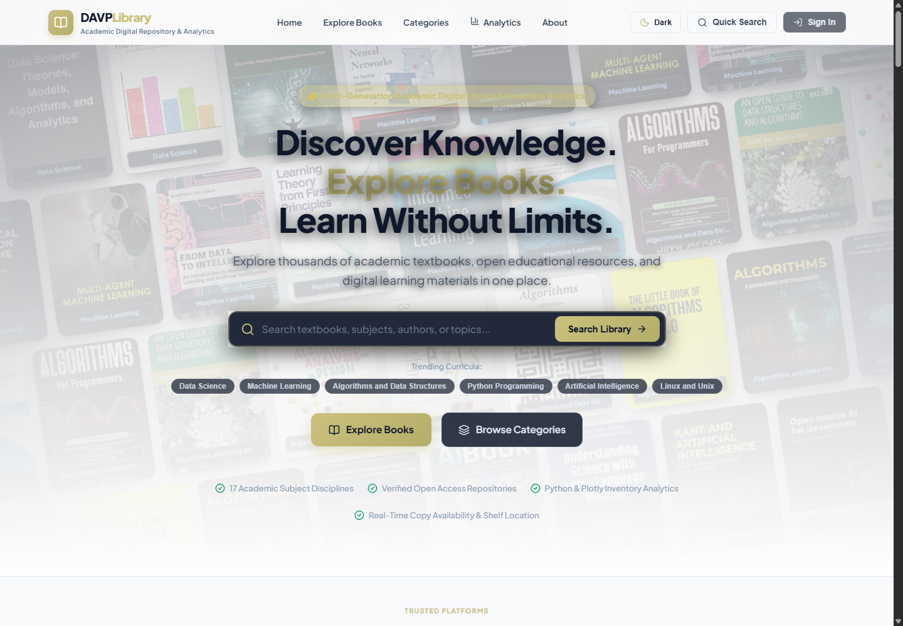

# 📚 DAVP Digital Library & Inventory Analytics Platform
### Production-Grade Academic Library Management, Python Analytics Engine, and Interactive Web Architecture

[](https://react.dev/)
[](https://vitejs.dev/)
[](https://www.python.org/)
[](https://plotly.com/python/)
[](https://pandas.pydata.org/)
[](LICENSE)

---

## 📸 Website Showcase & UI Gallery

Experience the DAVP Library interface designed with modern UI standards, smooth micro-interactions, dark/light themes, and deep institutional analytics.

### 1. Hero Showcase & Dynamic Drift Wall
> High-impact landing showcase featuring interactive animated textbook covers, cursor parallax, quick action jump buttons, and search shortcuts.



---

### 2. Comprehensive Textbooks Catalog & Management
> Filterable, searchable catalog supporting stock badges, availability counters, instant digital reading links, and administrator CRUD operations.



---

### 3. Python & Plotly Analytics Intelligence Dashboard
> 8 Executive KPI metrics, subject stock allocations, publication timeline trends, and 1.5×IQR statistical price outlier analysis faithfully translated from the Jupyter analytics engine.


---

### 4. Academic Subject Disciplines
> Curated collections spanning 17 academic faculties including Computer Science, AI, Mathematics, Physics, Chemistry, Mechanical Engineering, and Economics.



---

### 5. Verified Open Educational Repositories
> Seamless integration and partner marquee highlighting open platforms (OpenStax, Project Gutenberg, DOAB, Internet Archive, Google Books, and NDLI).



---

## 1. Project Overview & Description

The **DAVP Digital Library & Inventory Analytics Platform** is a dual-core academic resource management and business intelligence application. It bridges the gap between raw statistical data exploration conducted in Jupyter Notebooks ([`Textbooks_in_Library_Analysis_Using_Python.ipynb`](Textbooks_in_Library_Analysis_Using_Python.ipynb)) and an intuitive, real-time web portal tailored for students, faculty, and institutional administrators.

### Core Objectives:
1. **Curriculum Freshness Tracking**: Identify outdated editions (≥10 years old) to ensure academic curricula align with contemporary industry standards.
2. **Inventory & Circulation Intelligence**: Monitor real-time physical copies, track borrowed vs. available stock, and trigger automated low-stock and out-of-stock reorder alerts.
3. **Institutional Financial Valuation**: Estimate department-wise and publisher-wise catalog portfolio valuations in Indian Rupees (₹).
4. **Pedagogical Data Science**: Provide an authentic, standardized 700-record dataset ([`library_textbooks.csv`](library_textbooks.csv)) designed for teaching data cleaning, median imputation, IQR outlier detection, and correlation analysis.
5. **Role-Based Access Control (RBAC)**: Secure administrative catalog modification, deletion, and dataset ingestion with persistent Excel audit logging (`DAVP_Student_Login_Records.xlsx`).

---

## 2. Key Features

### 🌟 Modern Web Experience (Frontend)
- **`<GridMotion />` & `<DriftWall />` Animated Wall**: Multi-row drifting showcase of authentic academic textbook covers with cursor parallax and spotlight illumination.
- **`<LogoLoop />` Trusted Platform Marquee**: Continuous marquee featuring open educational repositories (OpenStax, Gutenberg, DOAB, NDLI).
- **Interactive Multi-Filter Catalog**: Instant real-time search across Book Title, Author, ISBN, Subject, Shelf, and Publisher with multi-tag filtering.
- **Responsive Dark & Light Modes**: System-aware visual theming accented with signature `#C9C17C` champagne gold tones.
- **Direct Digital Reading**: Direct one-click access to open-access PDFs and verified academic repositories.

### 📊 Real-Time Analytics & Business Intelligence
- **8 Executive KPI Cards**:
  - Total Book Records
  - Unique Book Titles
  - Total Physical Copies in Stock
  - Available Copies (with shelf percentage)
  - Borrowed Copies (circulation metrics)
  - Average Book Unit Price (₹)
  - Total Estimated Inventory Valuation (₹)
  - Number of Active Academic Subjects
- **Visual Analytics Tabs**:
  - **Subjects Distribution**: Ranked horizontal bar charts of volume and stock breakdown.
  - **Copies & Availability**: Grouped multi-bar comparison with a **50% target benchmark line**.
  - **Publication Timeline**: Longitudinal spline area chart tracking collection age and acquisition history.
  - **Valuation Analysis**: Financial asset allocation across university departments and publishers.
  - **1.5 × IQR Statistical Outliers**: Automated boxplot analysis isolating premium reference handbooks from standard coursework textbooks.

### 🛡️ Institutional Security & RBAC Logging
- **Multi-Role Authentication**: Student and Institutional Administrator roles.
- **Audit Logging via ExcelJS**: Real-time sign-ins, timestamps, and roles appended to [`DAVP_Student_Login_Records.xlsx`](DAVP_Student_Login_Records.xlsx).
- **Tamper Protection**: Protected administrative modal routes with unauthorized access triggers.

---

## 3. Dataset Architecture

The project includes an authentic, production-ready 700-record dataset provided in multiple formats for cross-platform compatibility:

- **Primary CSV**: [`library_textbooks.csv`](library_textbooks.csv)
- **Excel Workbook**: [`library_textbooks.xlsx`](library_textbooks.xlsx) (Formatted with frozen headers & typed data)
- **JSON Format**: [`library_textbooks.json`](library_textbooks.json)
- **Catalog Mirror**: [`library_textbooks_catalog.csv`](library_textbooks_catalog.csv)

### Dataset Schema (16 Attributes):
| Column | Type | Example | Description |
| :--- | :--- | :--- | :--- |
| `BookID` | String | `BK0007` | Unique textbook identifier |
| `Title` | String | `Compilers: Principles, Techniques, and Tools` | Full academic textbook title |
| `Author` | String | `Alfred V. Aho, Monica S. Lam, Ravi Sethi` | Contributing author(s) |
| `Subject` | String | `Computer Science` | Academic department or discipline |
| `Publisher` | String | `Pearson` | Publishing house |
| `PublicationYear`| Integer| `2018` | Year of publication |
| `ISBN` | String | `978-484143308` | 13-digit standard book identifier |
| `Price` | Float | `949.00` | Unit price in INR (₹) |
| `TotalCopies` | Integer| `18` | Total physical stock owned by library |
| `AvailableCopies`| Integer| `10` | Physical copies currently on the shelf |
| `BorrowedCopies` | Integer| `8` | Copies currently checked out by students |
| `Shelf` | String | `A-20` | Shelf location call number (Sections A to H) |
| `Source_Name` | String | `DAVP Central Library` | Repository or acquiring library branch |
| `Source_URL` | String | `https://library.davp.edu/catalog/BK0007` | Official catalog reference |
| `Reading_URL` | String | `https://library.davp.edu/digital/BK0007` | Digital access or reading URL |
| `License` | String | `Institutional Academic License` | Usage and lending license |

---

## 4. Technology Stack

### Frontend & Web Application
| Technology | Version | Purpose |
| :--- | :--- | :--- |
| **React** | `^18.3.1` | Component-driven user interface |
| **Vite** | `^6.0.7` | Blazing-fast development server and production bundler |
| **GSAP** | `^3.15.1` | High-performance smooth animations and transitions |
| **Lucide React**| `^1.16.0` | Modern, consistent iconography |
| **ExcelJS** | `^4.4.0` | Programmatic reading & writing of institutional Excel records |

### Python Data Science Engine ([`Textbooks_in_Library_Analysis_Using_Python.ipynb`](Textbooks_in_Library_Analysis_Using_Python.ipynb))
| Library | Purpose |
| :--- | :--- |
| **Python 3.10+** | Computational runtime |
| **Pandas** | DataFrame manipulation, grouping, aggregations, and cleaning |
| **NumPy** | Statistical arrays, IQR calculations, and vectorized metrics |
| **Plotly Express** | Interactive publication-grade web visualizations |
| **Matplotlib / Seaborn** | Exploratory static charts, correlation heatmaps, and boxplots |

---

## 5. Quick Start & Local Execution

### Prerequisites:
- **Node.js** (v18.0 or higher)
- **Python** (v3.10 or higher for Jupyter Notebook execution)
- **Git**

### 1. Web Application:
```bash
# 1. Clone the repository
git clone https://github.com/yenuglaganesh-dev/Davp-project-.git
cd Davp-project-

# 2. Install dependencies
npm install

# 3. Start local development server
npm run dev

# 4. Build for production preview
npm run build
npm run preview
```
Visit `http://localhost:5173` in your browser.

### 2. Python Notebook:
Open [`Textbooks_in_Library_Analysis_Using_Python.ipynb`](Textbooks_in_Library_Analysis_Using_Python.ipynb) in **VS Code**, **JupyterLab**, or **Google Colab**.

The notebook is pre-configured with:
```python
DATA_PATH = "library_textbooks.csv"  # Automatically loads the local dataset
```
Run all cells to execute statistical analyses, missing value diagnostics, and interactive Plotly figures.

---

## 6. Directory Structure

```text
Davp-project-/
│
├── docs/
│   └── screenshots/                        # High-resolution website showcase captures
│       ├── 01_hero_showcase.png
│       ├── 02_textbooks_catalog.png
│       ├── 03_analytics_dashboard.png
│       ├── 04_subject_disciplines.png
│       └── 05_open_repositories.png
│
├── public/                                 # Static web assets & cover images
│   ├── covers/                             # Authentic textbook cover artworks
│   └── library_textbooks.csv               # Static dataset mirror
│
├── src/                                    # Application source code
│   ├── components/                         # Modular React components
│   │   ├── HeroSection.jsx                 # DriftWall hero banner & search
│   │   ├── FeaturedTextbooks.jsx           # Catalog grid, book cards, search & filter
│   │   ├── AnalyticsSection.jsx            # 8 KPIs & 5 interactive visual tabs
│   │   ├── SubjectCategories.jsx           # 17 Faculty subject disciplines
│   │   ├── RepositoriesSection.jsx         # Open educational platform showcases
│   │   ├── BookModal.jsx                   # Book inspection & checkout dialog
│   │   ├── BookManagementModal.jsx         # Add / edit catalog record
│   │   ├── StudentManagementModal.jsx      # Student audit log & Excel viewer
│   │   └── LoginModal.jsx                  # RBAC authentication
│   ├── context/                            # React Context providers (Auth & Theme)
│   ├── data/                               # Catalog JSON & analytics compute engine
│   └── server/                             # ExcelJS auth middleware & logging
│
├── DAVP_Student_Login_Records.xlsx         # Live Excel attendance & audit records
├── library_textbooks.csv                   # Primary 700-record library dataset
├── library_textbooks.xlsx                  # Styled OpenXML Excel workbook
├── library_textbooks.json                  # JSON catalog dataset
├── library_textbooks_catalog.csv           # Admin export/import schema copy
├── Textbooks_in_Library_Analysis_Using_Python.ipynb # Core Python analytics notebook
├── index.html                              # Web entry point
├── package.json                            # Node.js dependencies & scripts
├── vite.config.js                          # Vite configuration & RBAC middleware
└── README.md                               # Complete project documentation
```

---

## 7. License

This project is open-source and distributed under the **MIT License**. See the `LICENSE` file for details.
