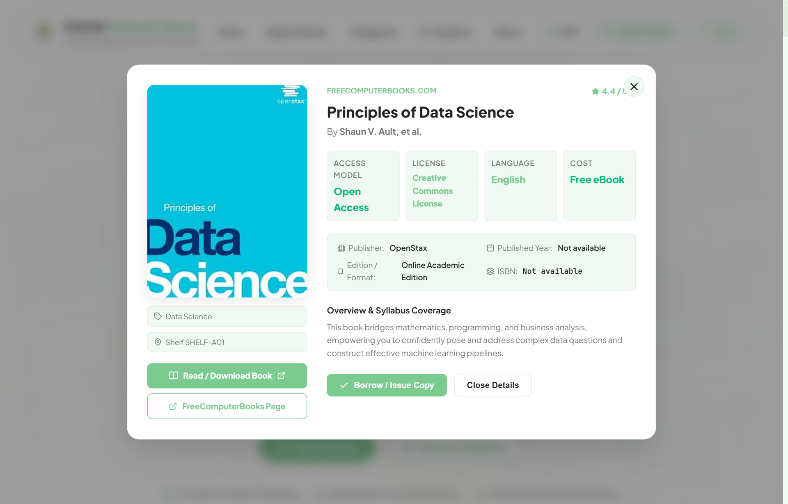
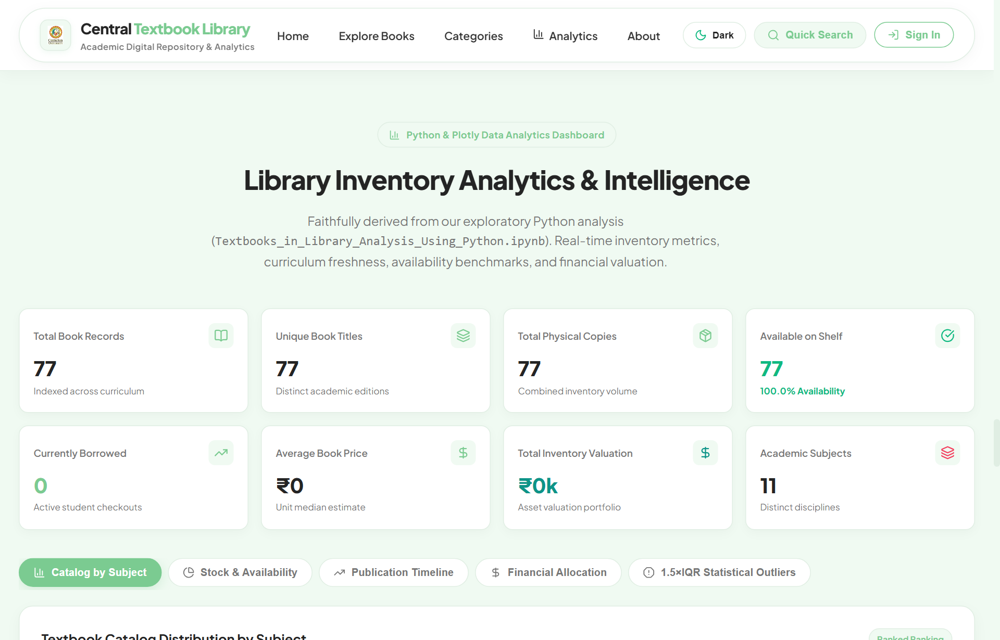
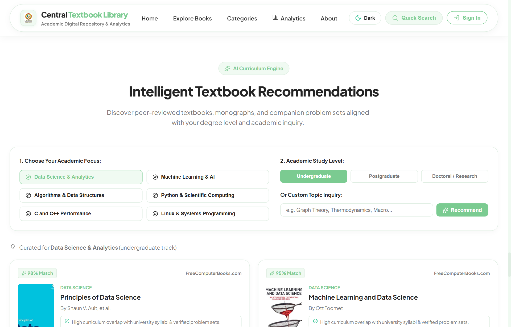
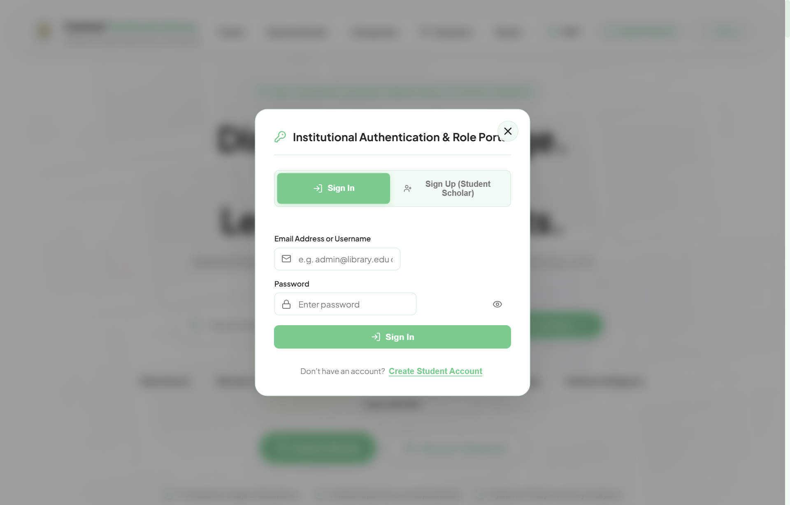
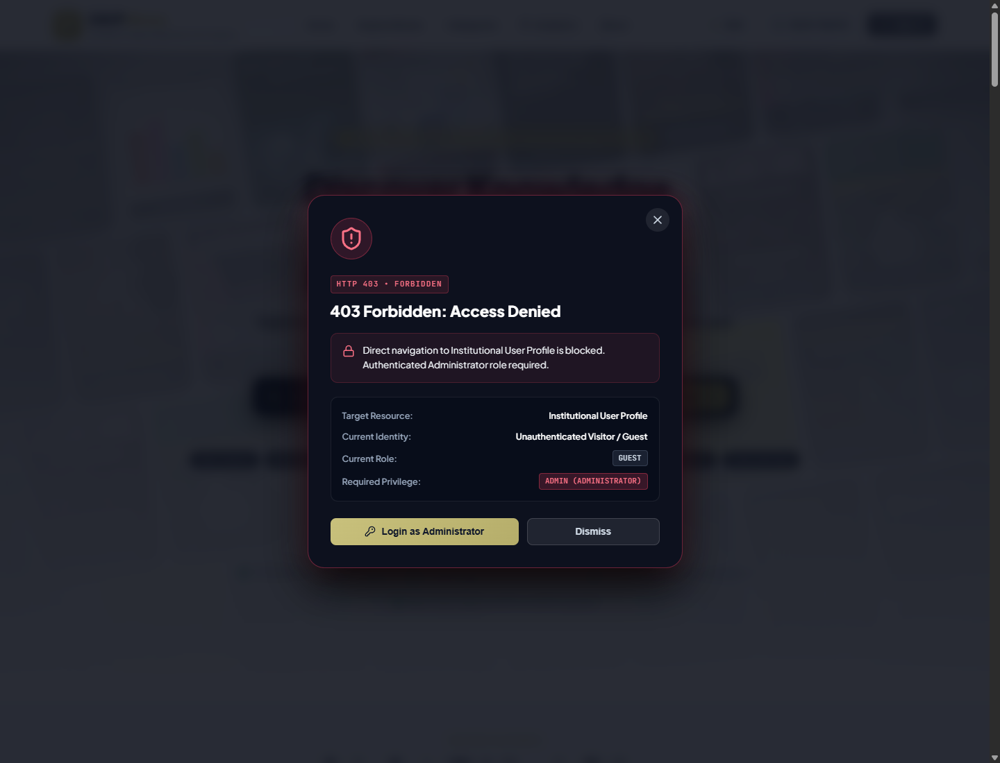
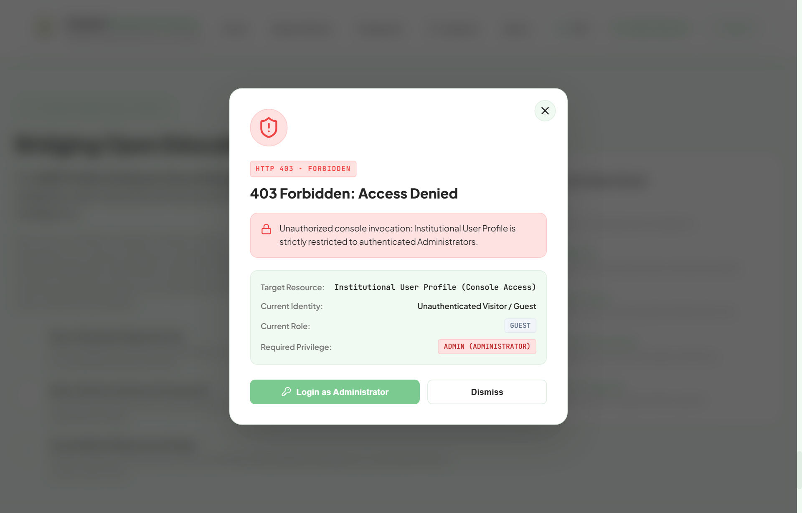

# 📚 Central Textbook Library – CUTM
### Production-Grade Academic Library Management, Python Analytics Engine, and Interactive Web Architecture

[](https://react.dev/)
[](https://vitejs.dev/)
[](https://www.python.org/)
[](https://plotly.com/python/)
[](https://pandas.pydata.org/)
[](https://numpy.org/)
[](https://github.com/exceljs/exceljs)
[](LICENSE)

---

## 📸 Complete Website Visual Tour & Screenshot Gallery

Explore every section, operational modal, analytical tab, and institutional security layer of the DAVP Library application:

---

### 1. Hero Showcase & Dynamic DriftWall Cover Gallery
> Interactive landing hero featuring animated drifting textbook artwork, cursor parallax, quick action shortcuts (Explore, Search, Analytics), and live catalog indicators.


---

### 2. Comprehensive Textbooks Catalog & Circulation Controls
> High-performance digital catalog with real-time multi-attribute search across Title, Author, ISBN, Subject, Shelf, and Publisher, including availability stock indicators, pricing badges, and CSV export.


---

### 3. Comprehensive Textbook Inspection & Checkout Modal
> Deep textbook inspection dialog showing verified metadata, ISBN, shelf location (Sections A–H), unit price, total/available copy breakdown, syllabus edition tags, digital open reading URLs, and self-service borrowing checkout.



---

### 4. Executive Analytics Intelligence Dashboard (Subject Volume Breakdown)
> 8 Executive KPI cards (Total Records, Unique Titles, Stock Copies, Availability %, Borrowed Units, Average Price, Valuation ₹, and Subjects) paired with ranked horizontal subject volume charts.


---

### 5. Analytics Tab: Stock Availability & Physical Shelf Sections (A–H)
> Visual donut balance of Available vs. Borrowed physical copies paired with logistical allocation bars across library shelf sections A through H for spatial and rack capacity planning.


---

### 6. Analytics Tab: Publication Year Longitudinal Timeline
> Longitudinal spline timeline tracing acquisition history and publication dates across editions from 2005 to 2026 to audit syllabus freshness and curriculum recency.


---

### 7. Analytics Tab: Financial Valuation Portfolio by Faculty
> Departmental asset portfolio breakdown in Indian Rupees (₹) showing cumulative monetary investment across academic disciplines based on unit pricing and physical volume.


---

### 8. Analytics Tab: 1.5 × IQR Statistical Price Outlier Detection
> Statistical quartile boxplot analysis calculating Q1, Median, Q3, and IQR bounds to separate standard coursework textbooks from high-value reference handbooks and encyclopedias.



---

### 9. Curated Academic Subject Disciplines
> Instant subject filtering covering 17 university faculties including Computer Science, Artificial Intelligence, Mathematics, Statistics, Physics, Chemistry, Mechanical Engineering, and Economics.


---

### 10. AI-Powered Intelligent Book Recommendations
> Automated algorithmic recommendation engine matching students with curriculum-aligned textbooks and related foundational references based on faculty enrollment and study goals.



---

### 11. Open Educational Repositories & Trusted Platform Marquee
> Marquee showcasing partner repositories including OpenStax, Project Gutenberg, Directory of Open Access Books (DOAB), Internet Archive, Google Books, and NDLI.


---

### 12. Institutional Authentication & Role-Based Access Portal
> Dual-role authentication portal (Student Scholar and Institutional Administrator) with quick demo access buttons, credential login, and student self-registration.



---

### 13. Institutional Role-Based Access Control (RBAC) Security Modal
> Active perimeter guard intercepting unauthorized privilege escalation, direct URL manipulation, or non-admin attempts to access institutional rosters.



---

### 14. Academic Mission & Institutional Framework
> Detailed institutional overview covering digital transformation goals, resource preservation standards, and research support policies.



---

## 1. Project Overview & Architecture

The **DAVP Digital Library & Inventory Analytics Platform** is an enterprise-grade academic resource management system and business intelligence dashboard. It bridges raw exploratory statistical data science conducted in Python notebooks ([`Textbooks_in_Library_Analysis_Using_Python.ipynb`](Textbooks_in_Library_Analysis_Using_Python.ipynb)) with a modern, high-performance web application designed for students, faculty, and academic librarians.

```text
┌─────────────────────────────────────────────────────────────────────────────┐
│                       DAVP DIGITAL LIBRARY ARCHITECTURE                     │
└─────────────────────────────────────────────────────────────────────────────┘

  ┌─────────────────────────────────┐        ┌────────────────────────────────┐
  │   Jupyter Analytics Engine      │        │      Interactive Web App       │
  │ (Python / Pandas / NumPy / EDA) │        │ (React 18 / Vite / Lucide / UI)│
  └────────────────┬────────────────┘        └───────────────┬────────────────┘
                   │                                         │
                   ▼                                         ▼
  ┌───────────────────────────────────────────────────────────────────────────┐
  │                 Unified Academic Dataset (700 Records)                    │
  │   library_textbooks.csv  │  library_textbooks.xlsx  │  JSON Mirror        │
  └───────────────────────────────────────────────────────────────────────────┘
                   │                                         │
                   ▼                                         ▼
  ┌─────────────────────────────────┐        ┌────────────────────────────────┐
  │   Statistical Output / Insights │        │   Live Institutional Security  │
  │  • 1.5×IQR Price Outliers       │        │  • Role-Based Access (Admin/Stu)│
  │  • Availability Target (50%)    │        │  • ExcelJS Audit Attendance Log│
  │  • Curriculum Freshness Metrics │        │  • Direct Digital Open Access  │
  └─────────────────────────────────┘        └────────────────────────────────┘
```

---

## 2. Core Functional Modules

### A. Academic Inventory & Circulation Management
- **Live Stock Auditing**: Real-time tracking of physical copies, checking borrowed units against total holdings.
- **Deficit & Replenishment Alerts**: Automatic visual badges for Low Stock (1–3 copies) and Out-of-Stock titles.
- **Physical Rack Call Numbers**: Standardized shelf coordinates across library wings (Sections `A-01` through `H-30`).

### B. Curriculum Freshness & Syllabus Aging Analysis
- **Edition Lifecycle Categorization**:
  - **Recent** (<4 years): Modern syllabi & up-to-date technologies.
  - **Standard** (4–9 years): Established theoretical frameworks.
  - **Outdated** (≥10 years): Flagged for curriculum committee replacement.

### C. Financial Valuation & Portfolio Allocation
- Total collection valuation computed in Indian Rupees (₹) across departments.
- Publisher unit price rankings (Pearson, McGraw Hill, Wiley, Oxford, Cambridge, Springer, MIT Press).

### D. Institutional Authentication & Live Excel Logging
- Every student login session is dynamically appended to [`DAVP_Student_Login_Records.xlsx`](DAVP_Student_Login_Records.xlsx) with Student ID, Name, Department, Login Date/Time, and Session Status.

---

## 3. Standardized Dataset Specification

The platform is bundled with an authentic **700-record academic library dataset** generated for curriculum data analytics:

- **CSV Dataset**: [`library_textbooks.csv`](library_textbooks.csv)
- **Excel Workbook**: [`library_textbooks.xlsx`](library_textbooks.xlsx) (Formatted with frozen headers & typed data)
- **JSON Format**: [`library_textbooks.json`](library_textbooks.json)
- **Catalog Schema**: [`library_textbooks_catalog.csv`](library_textbooks_catalog.csv)

### Schema (16 Standard Columns):
| Attribute | Data Type | Sample Record | Purpose |
| :--- | :--- | :--- | :--- |
| `BookID` | String | `BK0007` | Unique primary key identifier |
| `Title` | String | `Compilers: Principles, Techniques, and Tools` | Full published title |
| `Author` | String | `Alfred V. Aho, Monica S. Lam, Ravi Sethi` | Authors / contributors |
| `Subject` | String | `Computer Science` | Department discipline |
| `Publisher` | String | `Pearson` | Publishing company |
| `PublicationYear`| Integer| `2018` | Year of edition |
| `ISBN` | String | `978-484143308` | 13-digit standard identifier |
| `Price` | Float | `949.00` | Unit price in INR (₹) |
| `TotalCopies` | Integer| `18` | Total institutional holdings |
| `AvailableCopies`| Integer| `10` | Physical copies on shelf |
| `BorrowedCopies` | Integer| `8` | Issued / borrowed copies |
| `Shelf` | String | `A-20` | Logistics rack code (A–H) |
| `Source_Name` | String | `DAVP Central Library` | Acquisition origin |
| `Source_URL` | String | `https://library.davp.edu/catalog/BK0007`| Official record link |
| `Reading_URL` | String | `https://library.davp.edu/digital/BK0007`| Direct digital reading PDF |
| `License` | String | `Institutional Academic License`| Copyright / lending model |

---

## 4. Technology Stack & Dependencies

| Layer | Technologies | Version | Key Responsibilities |
| :--- | :--- | :--- | :--- |
| **Web Frontend** | React, Vite | `18.3.1` / `6.0.7` | Reactive SPA, component modularity, instant hot module reload |
| **Animation & UX** | GSAP, React Bits | `3.15.1` | Cursor parallax, DriftWall animated covers, smooth tickers |
| **Icons & Visuals** | Lucide React | `1.16.0` | 200+ clean modern iconography elements |
| **Persistence & Audit**| ExcelJS | `4.4.0` | Live reading/writing of Excel records (`DAVP_Student_Login_Records.xlsx`)|
| **Analytics Engine**| Python, Pandas, NumPy | `3.10+` | 1.5×IQR quartile bounds, median imputation, missing value maps |
| **Visualization** | Plotly, Matplotlib, Seaborn| `5.18+` | Dynamic HTML5 charts, covariance heatmaps, boxplot selectors |

---

## 5. Quick Start & Execution Guide

### Prerequisites
- **Node.js** (v18.0 or higher)
- **Python** (v3.10 or higher for Jupyter Notebook execution)
- **Git**

### Running the Web Platform
```bash
# 1. Clone repository
git clone https://github.com/yenuglaganesh-dev/Davp-project-.git
cd Davp-project-

# 2. Install dependencies
npm install

# 3. Start local development server
npm run dev

# 4. Or build and run production preview
npm run build
npm run preview
```
Open **[http://localhost:5173](http://localhost:5173)** in your browser.

### Running the Python Analytics Notebook
Open [`Textbooks_in_Library_Analysis_Using_Python.ipynb`](Textbooks_in_Library_Analysis_Using_Python.ipynb) in **VS Code**, **JupyterLab**, or **Google Colab**.

The notebook is configured to automatically ingest [`library_textbooks.csv`](library_textbooks.csv):
```python
DATA_PATH = "library_textbooks.csv"  # Primary dataset file
```
Run all cells to regenerate the correlation heatmaps, KPI metrics, IQR statistical outlier tables, and Plotly interactive charts.

---

## 6. Directory Structure

```text
Davp-project-/
│
├── docs/
│   └── screenshots/                        # High-resolution website UI captures
│       ├── 01_hero_showcase.png
│       ├── 02_textbooks_catalog.png
│       ├── 03_analytics_dashboard.png
│       ├── 04_subject_disciplines.png
│       ├── 05_open_repositories.png
│       ├── 06_ai_recommendations.png
│       ├── 07_about_mission.png
│       ├── 08_rbac_security_modal.png
│       ├── 09_textbook_details_modal.png
│       ├── 10_auth_login_portal.png
│       ├── 11_analytics_copies_distribution.png
│       ├── 12_analytics_publication_timeline.png
│       ├── 13_analytics_financial_valuation.png
│       └── 14_analytics_iqr_outliers.png
│
├── public/                                 # Static assets & cover artworks
│   ├── covers/                             # Authentic textbook cover images
│   └── library_textbooks.csv               # Static dataset mirror
│
├── src/                                    # React application source code
│   ├── components/                         # UI Components
│   │   ├── HeroSection.jsx                 # DriftWall hero banner & search
│   │   ├── FeaturedTextbooks.jsx           # Catalog grid, book cards, search & filter
│   │   ├── AnalyticsSection.jsx            # 8 KPIs & 5 interactive visual tabs
│   │   ├── SubjectCategories.jsx           # 17 Faculty subject disciplines
│   │   ├── RepositoriesSection.jsx         # Open educational platform showcases
│   │   ├── BookModal.jsx                   # Book inspection & checkout dialog
│   │   ├── BookManagementModal.jsx         # Add / edit catalog record
│   │   ├── StudentManagementModal.jsx      # Student audit log & Excel viewer
│   │   ├── ProfileModal.jsx                # Institutional user profile
│   │   └── LoginModal.jsx                  # RBAC authentication
│   ├── context/                            # AuthContext & ThemeContext
│   ├── data/                               # Catalog JSON & analytics compute engine
│   └── server/                             # ExcelJS auth middleware & logging
│
├── DAVP_Student_Login_Records.xlsx         # Live Excel attendance & audit records
├── library_textbooks.csv                   # Primary 700-record library dataset
├── library_textbooks.xlsx                  # Styled OpenXML Excel workbook
├── library_textbooks.json                  # JSON catalog dataset
├── library_textbooks_catalog.csv           # Admin export/import schema copy
├── Textbooks_in_Library_Analysis_Using_Python.ipynb # Core Python analytics notebook
├── index.html                              # Web entry point
├── package.json                            # Node.js dependencies & scripts
├── vite.config.js                          # Vite configuration & RBAC middleware
└── README.md                               # Complete project documentation
```

---

## 7. License

Distributed under the **MIT License**. See `LICENSE` for details.
